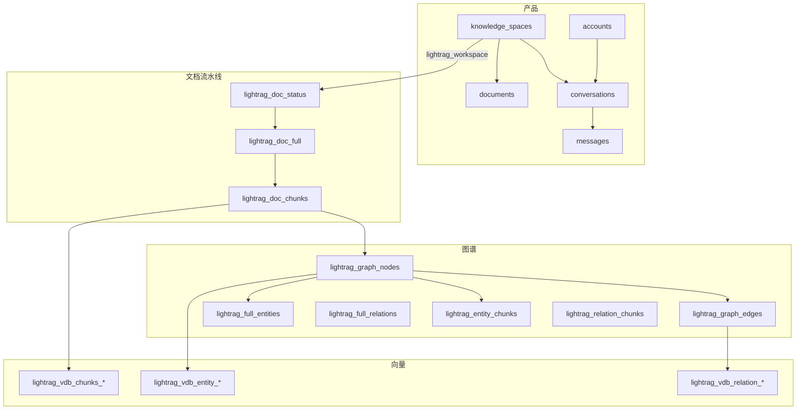

# PostgreSQL 表结构说明

库名 `rag`，全部在 `public` schema。两套表叠在同一库里：产品自己的账号/知识空间，以及 LightRAG Core 的文档、图谱、向量存储。隔离键几乎全是 `workspace`：同一套物理表，用工作区名字把不同知识空间的数据分开。

产品表与 LightRAG 表之间**没有外键**。接上业务后，`knowledge_spaces.lightrag_workspace` 应等于 LightRAG 各表里的 `workspace` 字段。

## 总览

## 产品表

我们自己的 SQLAlchemy 模型，定义在 `api/app/models.py`。

### accounts

登录账号。

| 列 | 含义 |
|---|---|
| `id` | 主键，32 位 hex |
| `username` | 唯一用户名 |
| `password_hash` | 密码哈希 |
| `created_at` | 创建时间 |

启动时若库里没有引导账号，会写入 `.env` 里的 `BOOTSTRAP_USERNAME` / `BOOTSTRAP_PASSWORD`。

### knowledge_spaces

知识空间。`lightrag_workspace` 创建后不再改，以后加成员权限也不用重建图谱。

| 列 | 含义 |
|---|---|
| `id` | 主键 |
| `name` | 界面显示名 |
| `lightrag_workspace` | 对应 LightRAG 的 workspace，唯一、不可变 |
| `created_at` | 创建时间 |

### documents

产品自己的文档记录。原文件在 `data/originals/{space_id}/{id}/`，不进 LightRAG 表。第 1 步上传后 `status` 为 `processing`，建库成功/失败在第 2 步改成 `ready` / `failed`。

| 列 | 含义 |
|---|---|
| `id` | 主键 |
| `space_id` | 所属知识空间 |
| `filename` | 界面文件名，打开原文时用这个名字 |
| `kind` | `pdf` / `docx` / `markdown` |
| `stored_path` | 相对 `data/originals` 的路径，替换时随文件名更新 |
| `status` | `processing` / `ready` / `failed` |
| `error_msg` | 失败原因 |
| `created_at` / `updated_at` | 时间 |

### conversations

产品侧对话。按「提问者 + 知识空间」落库。第一版列表按这两维过滤，不校验「只能打开自己的对话」。

| 列 | 含义 |
|---|---|
| `id` | 主键 |
| `space_id` | 所属知识空间 |
| `account_id` | 提问者 |
| `title` | 首问截断，最多 80 字 |
| `created_at` / `updated_at` | 创建时间；每次追问更新 |

### messages

对话里的一问或一答。来源标注只写在助手消息上。

| 列 | 含义 |
|---|---|
| `id` | 主键 |
| `conversation_id` | 所属对话 |
| `role` | `user` / `assistant` |
| `content` | 问题或回答正文 |
| `sources` | JSONB。助手消息：`[{filename, snippet, doc_id, page}, ...]`；用户消息为空。读对话时另加 `deleted`（文档行是否还在），不回写这列 |
| `created_at` | 时间 |

`doc_id` 在提问时按当前空间文件名解析写入。读旧对话时若该文档已删，响应里 `deleted=true`，界面显示「原文已删除」且不能打开。`page` 来自 LightRAG `file_path` 的 `#page=n`，不是模型自报页码。

## LightRAG：文档流水线

插入文本时顺序是：登记状态 → 存全文 → 切块。

### lightrag_doc_status

文档处理进度。看建库是否成功就查这张。主键 `(workspace, id)`。

| 列 | 含义 |
|---|---|
| `workspace` | 工作区 |
| `id` | 文档 id |
| `status` | 处理中 / 完成 / 失败 |
| `file_path` | 来源路径；纯文本插入时常为 `unknown_source` |
| `content_summary` | 摘要 |
| `content_length` | 原文长度 |
| `chunks_count` | 切块数 |
| `chunks_list` | 块 id 列表 |
| `track_id` | 一次插入的跟踪号，接口返回的就是它 |
| `content_hash` | 内容哈希，用于去重 |
| `error_msg` | 失败原因 |
| `metadata` | 附加 JSON |
| `created_at` / `updated_at` | 时间 |

### lightrag_doc_full

切块前的原文。主键 `(workspace, id)`。

| 列 | 含义 |
|---|---|
| `id` | 文档 id |
| `workspace` | 工作区 |
| `doc_name` | 文档名 |
| `content` | 全文 |
| `content_hash` | 内容哈希 |
| `parse_format` / `parse_engine` | 解析格式与引擎 |
| `meta` / `chunk_options` | JSON 元数据 |

### lightrag_doc_chunks

切好的文本块，mix 查询里「原文片段」的正文来源。主键 `(workspace, id)`。

| 列 | 含义 |
|---|---|
| `id` | 块 id |
| `workspace` | 工作区 |
| `full_doc_id` | 所属文档 |
| `chunk_order_index` | 块顺序 |
| `tokens` | token 数 |
| `content` | 块正文 |
| `file_path` | 来源路径 |
| `llm_cache_list` | 关联的 LLM 缓存 id |

## LightRAG：图谱

使用 `PGTableGraphStorage`，普通 PostgreSQL 表，不用 Apache AGE。

### lightrag_graph_nodes

实体节点。主键 `(workspace, namespace, id)`。

| 列 | 含义 |
|---|---|
| `workspace` | 工作区 |
| `namespace` | 默认 `chunk_entity_relation` |
| `id` | 实体名 |
| `properties` | 类型、描述等 JSONB |
| `updated_at` | 更新时间 |

### lightrag_graph_edges

实体之间的边。`src_id` / `tgt_id` 按字典序排成规范顺序，避免 A→B 和 B→A 各存一条。主键 `(workspace, namespace, src_id, tgt_id)`。

| 列 | 含义 |
|---|---|
| `workspace` | 工作区 |
| `namespace` | 默认 `chunk_entity_relation` |
| `src_id` / `tgt_id` | 两端实体 id |
| `properties` | 关系描述等 JSONB |
| `updated_at` | 更新时间 |

### lightrag_full_entities / lightrag_full_relations

按文档汇总：这篇文档抽到了哪些实体、哪些关系对。`entity_names` / `relation_pairs` 为 JSONB，`count` 为数量。主键 `(workspace, id)`，这里的 `id` 是文档 id。

### lightrag_entity_chunks / lightrag_relation_chunks

实体或关系到 chunk 的反向索引，查询时用来找回原文。`id` 是实体名或关系键，`chunk_ids` 为 JSONB。主键 `(workspace, id)`。

## LightRAG：向量

三类表，列里都有 `content_vector`（pgvector）：

- `lightrag_vdb_chunks_*`：chunk 向量，语义检索
- `lightrag_vdb_entity_*`：实体名/描述向量
- `lightrag_vdb_relation_*`：关系描述向量

共同主键 `(workspace, id)`。chunk 表另有 `full_doc_id`、`chunk_order_index`、`tokens`、`content`、`file_path`。entity 表有 `entity_name`。relation 表有 `source_id` / `target_id`。

**表名会带上 embedding 模型名和维度。** 换模型会建新表，不会覆盖旧表。库里可能同时存在：

| 表名模式 | 来源 | 是否在用 |
|---|---|---|
| `lightrag_vdb_chunks` 等无后缀 | 曾用空模型名启动 | 否 |
| `..._text_embedding_3_small_1536d` | 早期默认 OpenAI 1536 维 | 否 |
| `..._qwen3_7_text_embedding_flash_1024d` | 当前千问 embedding，1024 维 | 是 |

检索只走**当前模型那一套**。前两套是换模型留下的空壳，不要和 1024 维表混着看。维度必须与 `.env` 里 `EMBEDDING_DIM` 一致。

## LightRAG：辅助

### lightrag_llm_cache

LLM 抽取/查询结果缓存，减少重复打模型。主键 `(workspace, id)`。含 `original_prompt`、`return_value`、`cache_type`、`chunk_id`、`queryparam`。

### lightrag_config

LightRAG 运行配置。这张表的 `workspace` 列**不是**知识空间名，而是框架自己的分区常量；真正的工作区名写在 `id` / `value` 里。

## mix 查询如何串起来

`POST /api/rag/query` 使用 `QueryParam(mode="mix")`：

1. 用 `vdb_chunks` / `vdb_entity` / `vdb_relation` 做向量近邻。
2. 用 `graph_nodes` / `graph_edges` 取实体和关系。
3. 经 `entity_chunks` / `relation_chunks` 回到 `doc_chunks` 的原文。
4. 所有过滤都带 `workspace`，空间隔离靠这个字段，不是靠分库。

产品接上之后：用户进入某个知识空间 → 用该空间的 `lightrag_workspace` 调用 `ainsert` / `aquery_llm` → 数据只进、只出这一组 `workspace` 的行。
